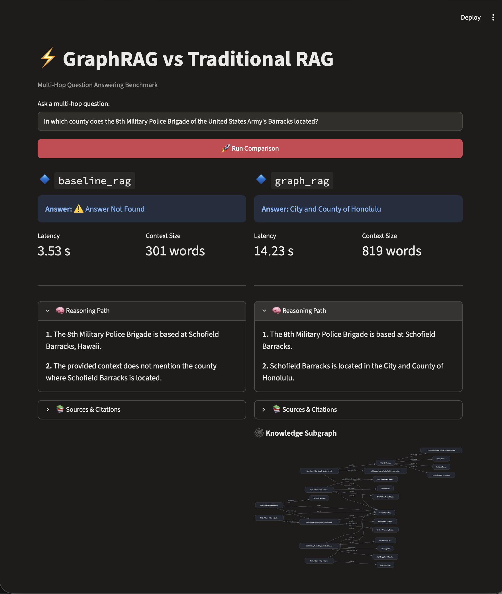
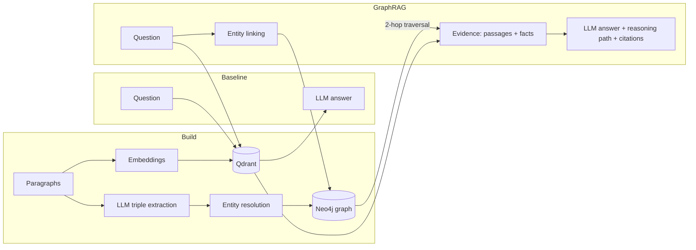
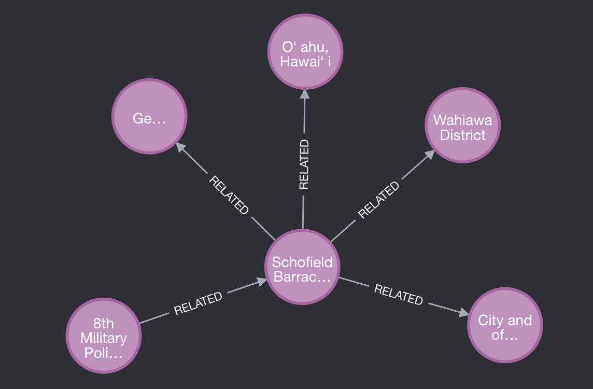

# GraphRAG vs. Vector RAG for Multi-Hop Question Answering


A knowledge-graph-augmented RAG system (**Neo4j + Qdrant + LLM**) compared against a vector-only baseline on
HotpotQA bridge questions, with an evaluation harness that reports effect sizes and confidence intervals.



## The problem

Multi-hop questions need facts from more than one document. Example: *"In which county does the 8th Military Police
Brigade's barracks sit?"* The brigade's page names Schofield Barracks, but only the Schofield Barracks page names the
county. That page shares few words with the question, so similarity search misses it and the baseline answers "unknown".
GraphRAG links the two entities and follows the path.

## Architecture



- **Ingest:** paragraphs go to Qdrant; an LLM extracts (head, relation, tail) triples (batched, cached on disk, resumable).
- **Entity resolution:** names are mapped onto document titles, e.g. `Schofield Barracks, Hawaii` to `Schofield Barracks`.
- **GraphRAG retrieval:** vector seeds, entity linking, 2-hop Cypher traversal (most specific entity first), bridge documents.
- **Generation:** both systems use the same prompt and return JSON with answer, reasoning path and citations.



## Results

Same LLM, prompt and embeddings for both systems. Development set: first 20 questions (used while debugging).
Held-out set: next 30 questions, not inspected before evaluation.

| Held-out (n=30)                                    | Baseline RAG | GraphRAG |
|----------------------------------------------------|--------------|----------|
| Exact match                                        | 0.433        | 0.467    |
| F1                                                 | 0.482        | 0.554    |
| All gold docs in retrieved passages                | 0.467        | 0.533    |
| All gold docs in prompt (passages or fact sources) | 0.467        | 0.700    |
| LLM calls per question                             | 1            | 2        |
| Average context (words)                            | 444          | 793      |

Paired bootstrap 95% CIs (GraphRAG minus baseline): EM [-0.10, +0.17] and F1 [-0.06, +0.21] are not significant;
evidence coverage [+0.07, +0.40] is significant (better on 8 questions, worse on 1).

Secondary, lenient scoring (dashes and spacing normalised, applied to both systems):
EM 0.433 vs 0.500, F1 0.504 vs 0.614 (baseline vs GraphRAG).

Reports: [held-out](results/report_heldout30.md) · [development](results/report_dev_first20.md) ·
[lenient re-scoring](results/rescored_heldout30.md) · [per-question scores](results/heldout30_per_question.csv)

**Takeaways**
- GraphRAG reliably puts more of the required evidence in front of the LLM.
- An answer-accuracy gain is not established at this sample size.
- Entity resolution was critical: the LLM created separate nodes for one place, which broke the multi-hop path.

## Limitations
- 30 held-out questions, one seed, one LLM, bridge questions only; the pipeline was tuned on the first 20.
- GraphRAG gets one more passage and about 1.8x more context than the baseline.
- The evidence metric credits a document if any of its facts is in the prompt, so it is an upper bound.
- Strict EM/F1 penalise some correct answers (dash and formatting variants).
- Latency is not reported: free-tier throttling and retries dominated timings.

## Quick start

```bash
python -m venv .venv && source .venv/bin/activate
pip install -r requirements.txt
cp .env.example .env              # set LLM_BASE_URL, LLM_API_KEY, LLM_MODEL
docker compose up -d              # Neo4j (7474/7687) + Qdrant (6333)
python scripts/download_data.py   # HotpotQA dev set
python -m mhqa.ingest --n 50      # extract triples, resolve entities, build both indexes
python -m mhqa.evaluate --offset 20 --n 30
streamlit run app.py
python -m pytest -q
```

Notes
- Works with any OpenAI-compatible endpoint. Set `LLM_MIN_INTERVAL` (seconds between calls) to stay under free-tier limits.
- Extraction is cached in `data/triples_cache.jsonl`; delete it when changing the LLM.
- `python -m mhqa.build_graph` rebuilds Neo4j from the cache (with entity resolution) without any LLM calls.
- Neo4j browser: http://localhost:7474 (user `neo4j`, password in `docker-compose.yml`; local development only).

## Project structure

```
mhqa/
  config.py  llm.py  data.py  utils.py
  extract.py       # LLM triple extraction (batched, cached)
  resolve.py       # entity resolution
  graph_store.py   # Neo4j access and traversal
  vector_store.py  # Qdrant access
  baseline_rag.py  graph_rag.py  generate.py
  ingest.py  build_graph.py  evaluate.py
tests/             # metrics + entity-resolution unit tests
scripts/           # dataset download
docs/              # screenshots, project report
results/           # evaluation reports
app.py             # Streamlit side-by-side demo
```

## Data and license
Code: MIT. The HotpotQA dataset (CC BY-SA 4.0) is downloaded by the script and is not included in this repository.
